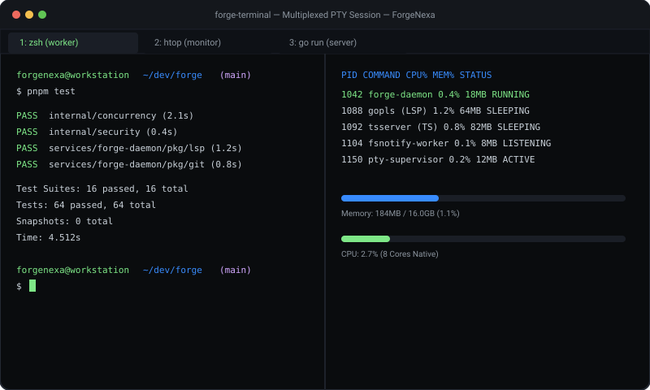

# Forge Terminal — High-Throughput Multiplexed Terminal Emulator

[](https://forgenexa.github.io/)

[](LICENSE)
[](https://golang.org)
[](https://xtermjs.org/)
[](https://react.dev/)
[](https://www.typescriptlang.org/)
[](https://github.com/ForgeNexa/forge-terminal/actions/workflows/ci.yml)

> **"Authentic OS pseudoterminals with zero orphaned processes."**  
> An open-source, local-first multiplexed terminal emulator built on native Go PTY session supervision and GPU-accelerated web rendering.

---

## 🏷️ Tags & Hashtags

`#ForgeNexa` `#ForgeTerminal` `#TerminalEmulator` `#PTY` `#DeveloperTools` `#DevTools` `#GoLang` `#React19` `#TypeScript` `#xtermjs` `#OpenSource` `#LocalFirst`

---

## ✨ Features

- **Genuine OS PTY Sessions**: Real pseudoterminal allocation using `creack/pty` supporting interactive shells (`/bin/zsh`, `/bin/bash`, `cmd.exe`).
- **Supervised Lifecycle**: Zero zombie processes — automatically tears down child processes upon terminal closure.
- **Dynamic Split Panes**: Horizontal and vertical tiling with independent scrollback buffers.
- **Modern Theme & Typography**: High-contrast 2026 dark themes with custom font ligatures.

---

## 🛠️ Build & Development

```bash
# Test the Go PTY Supervisor
cd supervisor
go test -v ./...

# Build the React 19 Terminal Workbench
cd ../web
bun install --frozen-lockfile
bun run build
```

---

## 🌐 Part of ForgeNexa

Forge Terminal is a standalone component of the [ForgeNexa Developer Tools Ecosystem](https://forgenexa.github.io/).

- [Forge IDE](https://github.com/ForgeNexa/forge-ide) — Code editor with Monaco and Go daemon
- [Forge API](https://github.com/ForgeNexa/forge-api) — High-throughput API testing client
- [Forge Git](https://github.com/ForgeNexa/forge-git) — Visual commit graph DAG and diff viewer
- [Forge Hub](https://github.com/ForgeNexa/forge-hub) — Unified ecosystem launcher
- [Forge Core](https://github.com/ForgeNexa/forge-core) — Shared Go systems foundation

---

## 📄 License

MIT © [ForgeNexa](https://forgenexa.github.io)
